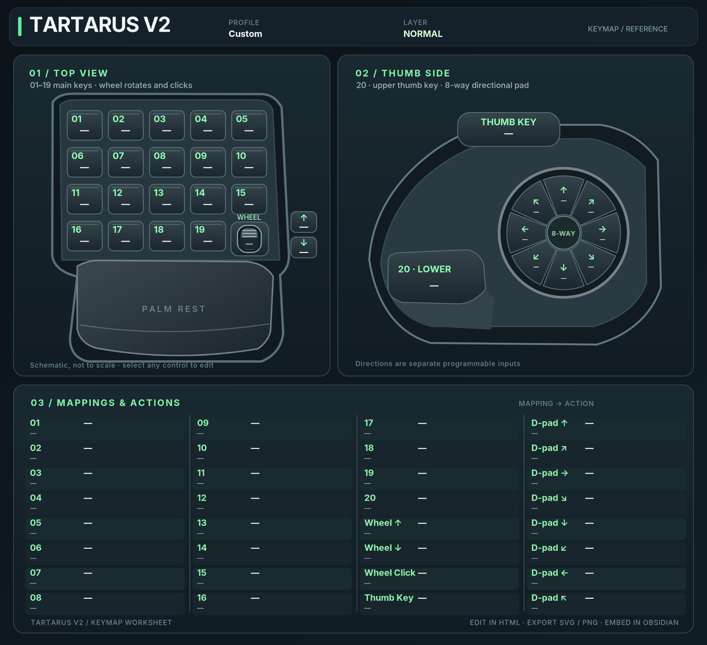

# Tartarus V2 Keymap Editor

A free, standalone visual keymap editor for the **Razer Tartarus V2**, particularly useful when planning mappings for Linux and [Input Remapper](https://github.com/sezanzeb/input-remapper).

## Preview

*The editable Tartarus V2 layout, showing the main keys, thumb controls, D-pad, and mapping worksheet.*

## Get started

1. Download [`index.html`](index.html) and open it in a modern browser (no installation or internet connection required).
2. Click a control in the diagram and enter a key mapping and an optional description.
3. Switch between **Normal** and **Hypershift** to edit separate layers.
4. Save a **Backup JSON** so you can load and edit your work later.
5. Export SVG, PNG, an Obsidian Markdown note, or a ChatGPT-compatible TXT file.

The editor saves changes in that browser's local storage. **Export a JSON backup** before clearing browser data or moving computers.

### Important distinction

**The HTML editor is a visual mapping worksheet.** It does **not** program the Tartarus directly and does **not** automatically generate an installable Input Remapper preset. Its ChatGPT TXT export can be used as an input when manually preparing a preset, which must be checked against the actual device's Linux input events.

## Tested Project Zomboid profile (Linux)

See [`examples/project-zomboid/Project-Zomboid-Tartarus-V3-Install.zip`](examples/project-zomboid/Project-Zomboid-Tartarus-V3-Install.zip).

This example is a JSON Input Remapper preset packaged in a ZIP. It was **tested and reported fully working by the contributor** with a Razer Tartarus V2 on **YETI / Pop!_OS**, including the D-pad, wheel, and Hypershift layer. The *upper thumb key* (usually Alt) acts as the Hypershift modifier; the lower thumb paddle is Space.

### Recommended Hypershift button

For a Tartarus V2 on Linux, we recommend using the **upper thumb button (normally mapped to Alt)** as the **Hypershift / layer-switch modifier**. This is the small upper thumb key, **not** button 20 (the large lower thumb paddle). It is a convenient place to hold a second mapping layer while keeping the lower paddle available for an action such as Space.

**Important:** If that upper thumb button still sends its original **Alt** keypress while being used for Hypershift, **disable or remove the original Alt binding** in your device/remapping configuration as needed so it does not interfere with the modifier or trigger unwanted Alt shortcuts. Check any conflicting in-game keybinds as well. You may need to adjust this depending on how your version of Input Remapper handles layers. Test both the normal layer and Hypershift before using the profile in a game.

The preset's input-event identifiers and device-origin hashes are machine/device specific. Other users may need to adapt the profile to their hardware and Input Remapper version. Some legacy comments in the preset say “provisional” or “verify”; they refer to the initial mapping process, not failed testing on the contributor's system.

### Using the example

1. Install and configure Input Remapper for your Linux distribution.
2. Back up any existing Tartarus V2 presets.
3. Extract the ZIP to obtain `Project-Zomboid-Tartarus-V2-WheelFix-DPadTest.json`.
4. Import or install the JSON through your Input Remapper version's supported preset workflow. Select the correct Tartarus V2 device, and confirm its event identities before enabling it.
5. Test Normal and Hypershift mappings in a safe application before playing.

**Do not overwrite a working preset without making a backup.** A mismatched device mapping can cause missing or unexpected keys.

## Files

- `index.html` — original standalone editable diagram and export tools.
- `assets/Tartarus-V2-Keymap-Blank.svg` — blank scalable reference sheet.
- `assets/Tartarus-V2-Keymap-Blank.png` — blank PNG reference sheet.
- `assets/tartarus-v2-keymap-editor-preview.png` — preview image displayed in this README.
- `examples/project-zomboid/Project-Zomboid-Tartarus-V3-Install.zip` — tested Linux Input Remapper example.

## Attribution and license

Created with AI assistance and refined using real-world Linux hardware testing. This is an independent community project, not affiliated with or endorsed by Razer or the Input Remapper maintainers.

Released under the [MIT License](LICENSE) in the GitHub repository. Keep the repository's existing `LICENSE` file when adding this release.
